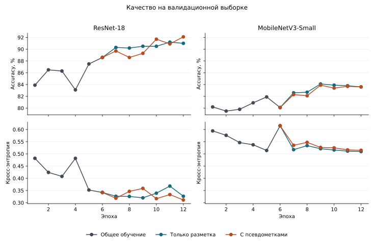
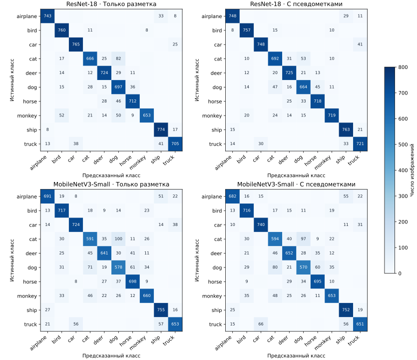

# Результаты экспериментов на STL-10

На официальном тесте из 8 000 изображений максимальную точность показала **ResNet-18 с псевдометками — 90,69%**. Все четыре модели обучены по 756 шагов. Веса для теста выбраны по точности на отдельной валидации из 1 000 изображений.

| Архитектура | Вариант | Выбранная эпоха | Accuracy на валидации | Верно на тесте | Accuracy на тесте | Macro-F1 на тесте |
| --- | --- | ---: | ---: | ---: | ---: | ---: |
| ResNet-18 | Исходная разметка | 11 | 91,20% | 7 199 | 89,99% | 0,9000 |
| ResNet-18 | С псевдометками | 12 | 92,10% | 7 255 | 90,69% | 0,9068 |
| MobileNetV3-Small | Исходная разметка | 9 | 84,10% | 6 708 | 83,85% | 0,8380 |
| MobileNetV3-Small | С псевдометками | 9 | 83,90% | 6 705 | 83,81% | 0,8375 |

## Эффект псевдометок

| Архитектура | Исправлено ошибок | Появилось ошибок | Изменение accuracy, п. п. | 95% интервал, п. п. |
| --- | ---: | ---: | ---: | ---: |
| ResNet-18 | 183 | 127 | +0,70 | от +0,275 до +1,125 |
| MobileNetV3-Small | 87 | 90 | −0,04 | от −0,3625 до +0,2875 |

На тех же 8 000 изображениях псевдометки дали ResNet-18 на 56 правильных ответов больше. У MobileNetV3-Small правильных ответов стало на три меньше, а интервал для разницы включает ноль. Интервалы получены парным бутстрэпом по тестовым изображениям с 10 000 повторений и характеризуют неопределённость при фиксированных весах. Для обучения использован один seed, 42.

## Отбор неразмеченных изображений

| Учитель | Прошли порог и согласие из 100 000 | Взяты для обучения | Прошли правило на валидации из 1 000 | Точность среди прошедших на валидации |
| --- | ---: | ---: | ---: | ---: |
| ResNet-18 | 50 047 | 3 000 | 735 | 97,55% |
| MobileNetV3-Small | 38 765 | 3 000 | 616 | 94,32% |

Учитель оставлял совпадающие предсказания для оригинала и зеркального отражения с вероятностью класса от 0,90 в обоих случаях. Для обучения применялся лимит 300 изображений на класс. Валидационная точность отбора измерена на десяти известных классах. У неразмеченной выборки состав шире, а истинные метки скрыты.

## Динамика обучения и ошибки

Первые шесть эпох общие для двух вариантов каждой архитектуры. Цветные линии показывают следующие шесть эпох. В верхнем ряду приведена accuracy, в нижнем — кросс-энтропия.

Обе сети чаще всего принимали кошку за собаку. Из 800 фотографий кошек ResNet-18 ошиблась таким образом на 82 при обучении с исходной разметкой и на 53 после добавления псевдометок. У MobileNetV3-Small число таких ошибок изменилось со 100 до 97.

Строки матриц соответствуют истинным классам, столбцы — предсказаниям. Шкала общая для всех четырёх моделей. Цифрами подписаны ячейки, содержащие хотя бы восемь изображений.

Эксперименты выполнены на Apple M1 Pro с ускорителем Metal, PyTorch 2.9.1 и Torchvision 0.24.1. Поэпоховые потери, точность, скорости обучения по группам, числа обучаемых параметров и все ячейки матриц сохранены в машиночитаемом виде. [Метрики эксперимента](metrics.json) · [Протокол и команды воспроизведения](../README.md)
